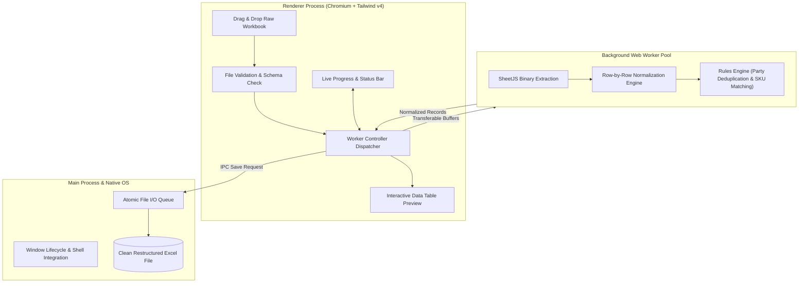

<div align="center">


# Prime Pending Pro

### High-Throughput Excel Pending Order Restructuring & Business Intelligence Engine

**Multi-Threaded Web Workers · Custom Rule Profiles · Instant Multi-Megabyte Ingestion · 100% Offline Desktop App**

<br />

<a href="https://github.com/Talha-Quraishi/Prime-Pending-Pro/releases/latest">
  
</a>

<br /><br />

[](https://github.com/Talha-Quraishi/Prime-Pending-Pro/releases/latest)
[-0078d4?style=flat&logo=windows&logoColor=white)](#installation--portable-builds)
[](https://opensource.org/licenses/MIT)
[-8b5cf6.svg)](#multi-threaded-processing-pipeline)
[](#tech-stack)
[](#security--hardening)

</div>

---

## ⚡ Quick Download & Installation

Choose between the automated Windows installer or the standalone zero-install portable build:

| Target | Description | Download |
| :--- | :--- | :--- |
| **Windows Installer (NSIS)** | Full setup wizard with Desktop & Start Menu shortcuts and uninstaller. | [**Download Setup .exe**](https://github.com/Talha-Quraishi/Prime-Pending-Pro/releases/latest) |
| **Standalone Portable** | Single `.exe` binary that runs instantly from flash drives or temp folders with no installation. | [**Download Portable .exe**](https://github.com/Talha-Quraishi/Prime-Pending-Pro/releases/latest) |

---

## 💡 What is Prime Pending Pro?

In enterprise wholesale, manufacturing, and supply chain workflows, pending order reports generated by legacy ERPs (such as Tally, SAP, or custom systems) are notoriously messy—featuring nested headers, irregular cell spans, inconsistent SKU naming, and party alias fragmentation.

**Prime Pending Pro** is a high-speed native Windows application engineered to transform raw, unformatted pending order Excel workbooks into clean, standardized, audit-ready data structures in seconds.

---

## 🔥 Key Features

### ⚡ Drag-and-Drop Ingestion with Worker Offloading
- **Instant Large File Parsing**: Drop raw `.xlsx` or `.xls` workbooks directly into the interactive dropzone.
- **Zero UI Freezing**: Heavy parsing and row transformation are delegated to background **Web Workers**, keeping the UI running at a fluid 60 FPS regardless of file size.
- **Cancellation & Progress Telemetry**: Real-time progress bar with time estimations and instant process abortion support.

### 🧠 Configurable Business Rule Engine
- **Party Alias Deduplication**: Match and unify variations of vendor and client names (e.g., "ABC Corp", "A.B.C. Corporation", "ABC Pvt Ltd") automatically.
- **SKU & Category Normalization**: Apply custom mapping tables to harmonize product codes, unit quantities, and rate tiers.
- **Custom Rule Profiles**: Save, export, and toggle multiple transformation rule presets tailored for different ERP export formats.

### 📊 Data Insights & Financial Breakdown
- **Real-Time Order Summaries**: Instant aggregation of Total Pending Order Value, Unit Quantities, and High-Exposure Accounts.
- **Party-Wise Aging & Exposure**: Identify which parties hold the largest backlog of unfulfilled commitments.
- **Interactive Data Table**: Search, filter, and inspect transformed records directly before saving.

### 🕒 History & Storage Management
- **Audit History**: Track recently processed batches with timestamped execution metrics.
- **Auto-Purge Manager**: Configurable local cache retention rules to keep disk usage lean and prevent storage clutter.

### 🛡️ Enterprise-Grade Security
- **Strict Renderer Sandboxing**: Renderer operates within a sandboxed context with disabled Node integration and locked navigation.
- **Context Isolation & Prototype Protection**: Object prototype pollution guards and HTML sanitizers ensure safe handling of untrusted spreadsheet content.
- **Atomic File Writes**: Concurrency write queue with exponential retry backoff to eliminate Windows `EPERM` / `EBUSY` file locking collisions.

---

## 🏗️ Multi-Threaded Processing Pipeline



---

## 💻 Local Development & Building

### Prerequisites
- [Node.js](https://nodejs.org/) (v18 or higher)
- [npm](https://www.npmjs.com/)

### 1. Clone the Repository
```bash
git clone https://github.com/Talha-Quraishi/Prime-Pending-Pro.git
cd Prime-Pending-Pro
```

### 2. Install Dependencies
```bash
npm install
```

### 3. Run Development Server
```bash
npm start
```

### 4. Run Test Suite & Linter
```bash
# Execute unit and deduplication tests
npm test

# Run ESLint validation
npm run lint
```

### 5. Compile Windows Binaries
```bash
# Build standard NSIS Windows Setup installer
npm run dist:installer

# Build single zero-install portable executable
npm run dist:portable

# Build all Windows targets
npm run dist
```

Compiled binaries will be generated inside the `dist/` directory.

---

## 🛠️ Tech Stack

- **Desktop Framework**: [Electron](https://www.electronjs.org/) (v43+)
- **Concurrency**: Web Workers API for off-thread processing
- **Styling**: [Tailwind CSS](https://tailwindcss.com/) (v4)
- **Workbook Engine**: SheetJS / xlsx parser & generator
- **Linting & Code Quality**: ESLint v10
- **Packaging Engine**: [electron-builder](https://www.electron.build/) (NSIS + Portable Windows Targets)

---

## 📄 License

This project is licensed under the **[MIT License](LICENSE)**.

---

<div align="center">

Engineered by **[Talha-Quraishi](https://github.com/Talha-Quraishi)**

</div>
